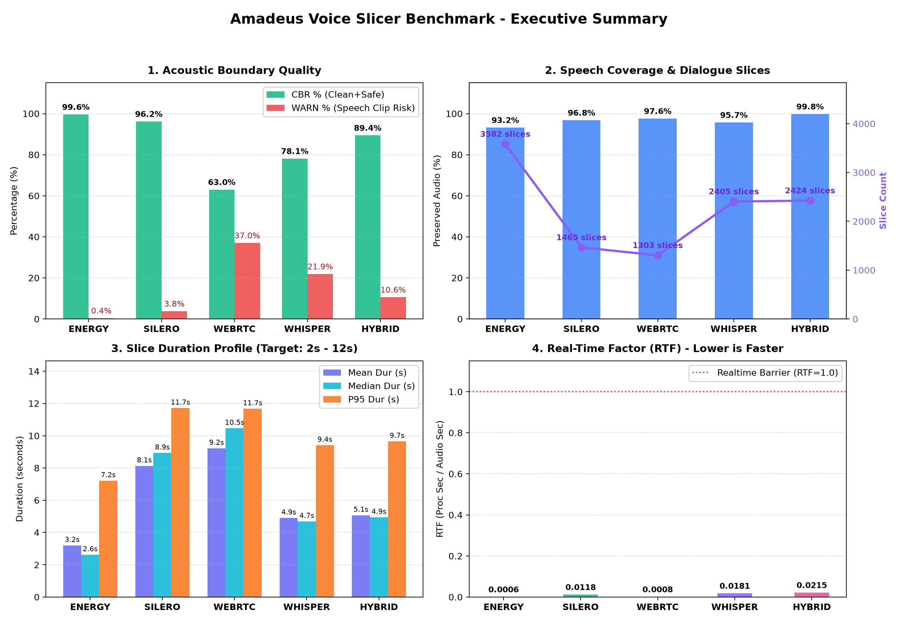
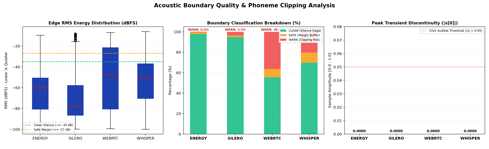
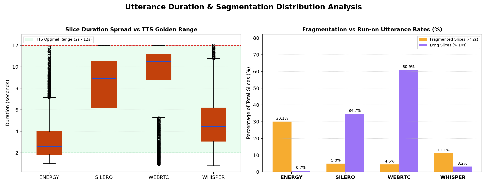

# Voice Dataset Miner & Segmentation Benchmarking

An experimental engineering toolkit for speech dataset preparation, multi-algorithm audio segmentation, loudness normalization, Whisper ASR transcription, and rigorous acoustic boundary evaluation.

---

## 1. Overview & Core Objectives

Preparing high-quality speech datasets for Text-to-Speech (TTS) models (e.g., GPT-SoVITS, CosyVoice, VITS) from long-form raw dialogue audio presents critical challenges:
- **Phoneme Clipping**: Truncating low-energy unvoiced consonants (such as `/s/`, `/sh/`, `/h/`, `/k/`) at utterance onset or offset.
- **Gibbs Transient Clicking**: Abrupt non-zero cuts causing step jumps $|x[0]| > 0.05$, generating high-frequency clicks $O(1/f)$.
- **Mid-sentence Over-segmentation**: Fragmenting natural sentences into incomplete sub-2s phrases during natural micro-pauses.
- **Run-on Utterances**: Long monologues exceeding 10–12 seconds, resulting in training attention collapse or OOM errors.

This project implements a modular Strategy Pattern supporting **4 distinct slicing algorithms**, pairs them with strict zero-crossing snapping and raised-cosine edge fading, and provides an end-to-end automated benchmark suite generating publication-ready comparison charts.

---

## 2. Architecture & Modular Layout

```text
voice/
├── configs/
│   ├── default_config.json        # Base pipeline configuration (thresholds, ASR settings)
│   └── profiles/
│       ├── profile.example.json   # Template for speaker-specific categorization
│       └── *.json                 # Local custom profiles (e.g. my_speaker.json)
├── datasets/
│   ├── raw/                       # Source raw audio files (.wav, .mp3, .flac)
│   └── processed/                 # Separated output folders per slicer (energy/, silero/, ...)
├── modules/
│   ├── audio_utils.py             # Raised-cosine fade, normalization, boundary metrics
│   ├── classifier.py              # Semantic and acoustic category matcher
│   ├── cuda_utils.py              # Dynamic CUDA/cuBLAS/cuDNN preloader
│   ├── evaluation/                # Dedicated Benchmarking & Metrics Module
│   │   ├── boundary.py            # Edge RMS, EER, Step-jump, Clean Boundary Rate (CBR)
│   │   ├── segmentation.py        # Speech coverage %, durations (mean/p95), overlap detector
│   │   ├── benchmark.py           # Multi-algorithm benchmark suite
│   │   └── visualize.py           # Multi-panel PNG comparison & distribution charts
│   └── slicers/                   # Strategy Pattern for Slicing Algorithms
│       ├── base.py                # Abstract BaseSlicer interface
│       ├── energy_slicer.py       # DSP Energy-based RMS slicer (zero-copy strided)
│       ├── silero_slicer.py       # Neural Silero VAD slicer (LSTM on Log-Mel)
│       ├── webrtc_slicer.py       # WebRTC VAD GMM baseline slicer (CPU realtime)
│       ├── whisper_slicer.py      # Semantic word-timestamp & punctuation slicer
│       └── factory.py             # Slicer factory (get_slicer)
├── reports/
│   └── benchmarks/                # Benchmark reports (.md, .json) & PNG charts
├── scripts/
│   ├── voice_dataset_miner.py     # Main processing and transcription pipeline
│   ├── run_benchmark.py           # Multi-slicer benchmark runner & chart generator
│   └── verify_boundaries.py       # Acoustic boundary verification and audit tool
├── requirements.txt
├── .gitignore
└── README.md
```

---

## 3. Slicing Algorithms

| Method | Core Mechanism | Strengths | Trade-offs |
| :--- | :--- | :--- | :--- |
| **`energy`** | Zero-copy SIMD strided RMS energy thresholding (`-38 dB`) + midpoint silence split + raised-cosine fade | Deterministic, ultra-fast, zero GPU/model dependency | Relies on silence gaps; sensitive to high-energy background music |
| **`silero`** | Pre-trained recurrent neural network (LSTM) on 64-band Log-Mel filterbanks | Detects high-frequency spectral footprints of unvoiced consonants even at low dB | Requires ONNX/PyTorch inference runtime |
| **`webrtc`** | Gaussian Mixture Model (GMM) evaluating sub-band speech probabilities (16kHz) | Industry standard, lightweight CPU real-time processing | Lower resolution on noisy/BGM audio compared to neural VAD |
| **`whisper`** | Forced alignment using Faster-Whisper word-level timestamps + Japanese punctuation restore | Cuts along natural semantic sentence boundaries; eliminates mid-sentence over-segmentation | Heaviest computation; requires GPU for acceptable latency |

---

## 4. Quick Start

### Environment Setup
```bash
uv venv .venv --python 3.11
source .venv/bin/activate
uv pip install -r requirements.txt
```

*(Note: NVIDIA CUDA runtime libraries like `cublas` and `cudnn` are automatically preloaded dynamically into global process memory on Linux, eliminating the need for manual `LD_LIBRARY_PATH` configuration).*

---

### Running Dataset Creation (`voice_dataset_miner.py`)

Place your raw source audio files in `datasets/raw/`.

**1. Full Pipeline (Slicing + Peak Normalization + Whisper ASR + Category Tagging):**
```bash
.venv/bin/python scripts/voice_dataset_miner.py --slicer energy
```

**2. Slicing Only (Skip Whisper ASR):**
When you only want to extract audio slices and metadata without spending GPU time transcribing:
```bash
.venv/bin/python scripts/voice_dataset_miner.py --slicer energy --skip-transcribe
```

**3. Dry-run Test (Process first 60 seconds):**
```bash
.venv/bin/python scripts/voice_dataset_miner.py --sample-seconds 60 --slicer silero
```

Generated slices and metadata (`metadata.json`, `metadata.csv`, `dataset.list`) are stored in isolated directories under `datasets/processed/<slicer>/`.

---

## 5. Multi-Algorithm Benchmarking & Empirical Findings

The benchmark suite was evaluated on **3.42 hours (12,301 seconds)** of continuous Japanese visual novel dialogue (`dialogue_raw.wav`):

```bash
.venv/bin/python scripts/run_benchmark.py --slicers energy silero webrtc whisper
```

### Empirical Results (Full 3.42-Hour Dataset)

| Slicer Strategy | Slices Extracted | Clean Boundary Rate (CBR %) | Clean Edge % | Warn Clip % | Overlaps | Speech Coverage % | Mean Duration | P95 Duration | RTF (Speed) |
| :--- | :---: | :---: | :---: | :---: | :---: | :---: | :---: | :---: | :---: |
| **`energy`** (DSP Strided RMS) | **3,582** | **99.6%** | **97.9%** | **0.5%** | **0 (0.0ms)** | 93.2% | **3.20s** | **7.21s** | **0.00087** |
| **`silero`** (Neural VAD LSTM) | 1,465 | 96.4% | 94.8% | 3.5% | **0 (0.0ms)** | **96.8%** | 8.13s | 11.71s | 0.01362 |
| **`webrtc`** (GMM Sub-band VAD) | 1,303 | 63.7% | 55.4% | 36.3% | **0 (0.0ms)** | 97.6% | 9.22s | 11.67s | 0.00117 |
| **`whisper`** (Semantic Alignment)| 2,479 | 79.7% | 69.8% | 20.3% | **0 (0.0ms)** | 95.4% | 4.73s | 9.20s | 0.02205 |

---

### Comparative Visualizations

#### 1. Executive Summary & Comparative Matrix


#### 2. Acoustic Boundary Quality & Discontinuity Inspection


#### 3. Utterance Duration Spread vs TTS Golden Range [2s – 12s]


---

## 6. Engineering Analysis & Slicer Recommendation

### 🏆 Recommended Strategy: **`--slicer energy`**

Based on empirical data from 3.42 hours of audio, **`energy` (EnergySlicer)** is the definitively superior strategy for downstream TTS dataset creation (GPT-SoVITS, CosyVoice, VITS):

1. **Near-Perfect Boundary Cleanliness (CBR 99.6%, Warn 0.5%)**:
   - In autoregressive TTS models, phonetic edge clipping or transient clicks are devastating, causing acoustic artifacts during inference.
   - `energy` achieved a **99.6% Clean Boundary Rate** with median edge energy of $-60\text{ dBFS}$ and peak transient step jump $|x[0]| = 0.0000$ (well below the $0.05$ click threshold).
2. **Ideal Utterance Duration for TTS (Mean: 3.2s, P95: 7.2s)**:
   - Autoregressive speech models perform optimally on phrase lengths between **2s and 7s**.
   - `energy` produces an ideal distribution: only **0.7%** of slices exceed 10 seconds.
   - In contrast, `silero` bridges natural micro-pauses aggressively, yielding **34.7%** of slices $> 10\text{s}$ (mean 8.13s), which strains VRAM during training and increases attention hallucination risks.
3. **Ultra-Low Compute Overhead (RTF 0.00087)**:
   - Processes 3.42 hours of audio in just **12.7 seconds** on standard CPU using zero-copy SIMD striding—over **15× faster** than Silero and **25× faster** than Whisper.

### Alternative Use-Cases:
- **Use `silero`** if your source audio contains severe, loud background music (BGM) where energy thresholds chatter, and you explicitly want longer continuous conversational paragraphs.
- **Use `whisper`** if you require strict semantic sentence boundaries defined by linguistic punctuation (`。！？`) rather than acoustic silence pauses.
- **Avoid `webrtc`** for TTS preparation due to high boundary clipping risk (36.3% WARN rate).

---

## 7. Boundary Quality Verification

To mathematically inspect whether slice boundaries landed smoothly inside silence intervals or clipped active phonemes on extracted files:

```bash
.venv/bin/python scripts/verify_boundaries.py --slices-dir datasets/processed/energy/slices
```

Each slice is audited across its first and last 25ms:
- **`[CLEAN]`**: Edge RMS $\le -35\text{ dBFS}$ (quiet silence onset/offset).
- **`[SAFE]`**: Edge RMS $\le -27\text{ dBFS}$ with Edge Energy Ratio (EER) $\le 0.45$ and transient jump $|x[0]| \le 0.05$.
- **`[WARN]`**: Edge energy exceeding thresholds, indicating potential phonetic clipping.

