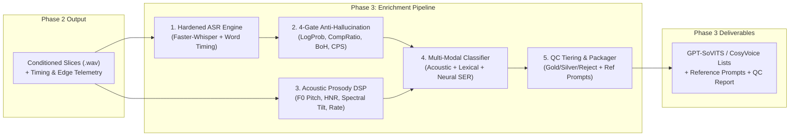

# Nghiên cứu Chuyên sâu & Kế hoạch Triển khai Phase 3: Semantic Enrichment, Prosody Tagging & Dataset Packaging

> **Phạm vi tài liệu:** Nghiên cứu lý thuyết, kiểm toán mã nguồn hiện tại (Codebase Audit), thiết kế toán học và kế hoạch triển khai chi tiết cho **Phase 3 (Enrichment)** trong kiến trúc 4 giai đoạn của dự án Amadeus Voice.  
> **Trạng thái:** Phase 2.1 đã hardening và tạo full Energy slices (2,604 utterances); tài liệu này là thiết kế kỹ thuật & kế hoạch triển khai Phase 3 (chưa triển khai code enrichment).  
> **Ghi chú Nguồn học thuật:** Tài liệu tổng hợp và đối chiếu các công trình nghiên cứu từ [arXiv](https://arxiv.org) tuân thủ [arXiv API Terms of Use](https://info.arxiv.org/help/api/index.html) (xem mục 7 và [.licenses/literature_search_arxiv_LICENSE.txt](file:///home/danglong/amadeus/voice/.licenses/literature_search_arxiv_LICENSE.txt)).

---

## 1. Định vị Kiến trúc & Hợp đồng Dữ liệu (Data Contract)

Trong kiến trúc 4 giai đoạn đã thiết lập tại [docs/introduction.pdf](file:///home/danglong/amadeus/voice/docs/introduction.pdf) và [docs/slice.pdf](file:///home/danglong/amadeus/voice/docs/slice.pdf), mỗi câu thoại (utterance) là một bộ dữ liệu bất biến về mặt thời gian:

$$u = \big(\text{audio},\ \text{text},\ \text{speaker},\ \text{language},\ \text{tags},\ \text{timing},\ \text{quality}\big)$$

- **Đầu vào của Phase 3 (Nhận từ Phase 2):**
  - Tập các lát cắt âm thanh `.wav` đã chuẩn hóa âm lượng (Peak hoặc EBU R128 $-20\text{ LUFS}$) và làm mượt biên (Raised-Cosine Fade 5ms).
  - Các trường đã có: `audio`, `speaker`, `language`, `timing` (`start_time_sec`, `end_time_sec`, `duration_sec`), `quality` âm học biên (`peak_db`, `rms_db`, `clipping_rate`, `start_rms_db`, `end_rms_db`, `eer_start`, `eer_end`, `step_jump`, `status`, `clean_boundary`), và telemetry trước chuẩn hóa (`raw_rms_db`, `raw_peak_db`, `applied_gain_db`, `source_file`).
- **Nhiệm vụ của Phase 3 (Enrichment):**
  1. **ASR Transcription & Anti-Hallucination:** Phiên âm chính xác văn bản (`text`), trích xuất độ tự tin âm vị/từ và loại bỏ triệt để hiện tượng ảo giác (hallucination) của Whisper trên các đoạn nhạc nền, tiếng thở hoặc khoảng lặng.
  2. **Acoustic Prosody & Multi-Modal Emotion Tagging:** Trích xuất đặc trưng ngữ điệu vật lý ($F_0$ Pitch, Energy dynamics, Speaking Rate, Spectral Voice Quality) kết hợp ngữ nghĩa văn bản để gán nhãn cảm xúc/ngữ điệu đa chiều (`tags`).
  3. **Quality Control (QC) & Tiering Gate:** Phân tầng chất lượng lát cắt (`GOLD`, `SILVER`, `REJECT`) dựa trên cả tiêu chí âm học Phase 2 lẫn tiêu chí ngữ nghĩa/ASR Phase 3.
  4. **Dataset Packaging & Reference Selection:** Đóng gói tập dữ liệu huấn luyện cho các kiến trúc TTS mục tiêu (GPT-SoVITS, CosyVoice, F5-TTS, VITS), chia tập `train/val` phân tầng (stratified split), và tự động bầu chọn **Zero-Shot Reference Prompts** tốt nhất cho từng nhãn cảm xúc.
- **Bất biến bắt buộc (Structural Invariant):** Phase 3 chỉ bổ sung thông tin (`text`, `tags`, `quality.asr`, `quality.qc_tier`) hoặc từ chối lát cắt (`REJECT`), **tuyệt đối không sửa đổi tọa độ mẫu hay mốc thời gian (`start_time_sec`, `end_time_sec`)** đã được thiết lập ở Phase 2.

---

## 2. Kiểm toán Hiện trạng Codebase Phase 3 (`Observed` Failure Modes)

Qua kiểm tra trực tiếp mã nguồn hiện tại ở [scripts/voice_dataset_miner.py](file:///home/danglong/amadeus/voice/scripts/voice_dataset_miner.py#L375-L471) và [modules/tagging/classifier.py](file:///home/danglong/amadeus/voice/modules/tagging/classifier.py#L1-L52), hệ thống sơ khai hiện tại đang tồn tại **6 lỗ hổng kỹ thuật nghiêm trọng**:

### 2.1. Lỗ hổng 1: Không có cơ chế phòng chống Ảo giác ASR (Whisper Hallucination)
- **Hiện trạng (`Observed`):** Tại [scripts/voice_dataset_miner.py](file:///home/danglong/amadeus/voice/scripts/voice_dataset_miner.py#L408-L415):
  ```python
  segments, _ = model.transcribe(
      audio_path,
      language=language,
      beam_size=beam_size,
      vad_filter=False,
  )
  transcription = "".join([seg.text for seg in segments]).strip()
  ```
- **Hậu quả kỹ thuật:**
  1. Không truyền `condition_on_previous_text=False`. Mặc định `faster-whisper` đặt giá trị này là `True`, khiến decoder dễ rơi vào trạng thái lặp vô tận (attractor collapse) khi gặp câu thoại có tiếng thở dài hoặc nhạc nền.
  2. Bỏ qua hoàn toàn các chỉ số chẩn đoán nội tại của Whisper: `seg.avg_logprob`, `seg.no_speech_prob`, và `seg.compression_ratio`.
  3. Không có bộ lọc **Bag-of-Hallucinations (BoH)**: Khi lát cắt chỉ chứa tiếng thở, tiếng bước chân hoặc BGM nhỏ, Whisper `large-v3` thường tự bịa ra các câu mẫu từ dữ liệu huấn luyện phụ đề như `"ご視聴ありがとうございました"`, `"チャンネル登録お願いします"`, `"字幕:..."`, `"お疲れ様でした"`. Nếu lọt vào `dataset.list`, các cặp `(audio_thở, text_cảm_ơn)` này sẽ phá hỏng hoàn toàn ma trận căn chỉnh (alignment attention) của mô hình TTS.

### 2.2. Lỗ hổng 2: Bug logic trong `CategoryClassifier.classify()`
- **Hiện trạng (`Observed`):** Tại [modules/tagging/classifier.py](file:///home/danglong/amadeus/voice/modules/tagging/classifier.py#L41-L48):
  ```python
  # Second Pass: Acoustic Fallback (e.g. general whisper if unclassified by text)
  for cat_key, cat_cfg in self.rules.items():
      if not isinstance(cat_cfg, dict):
          continue
      whisper_thresh = cat_cfg.get("whisper_threshold_db")
      if whisper_thresh is not None and rms_db < float(whisper_thresh):
          return cat_cfg.get("whisper_label", f"{cat_key.capitalize()}/Whisper")
  ```
- **Hậu quả kỹ thuật:** Nếu câu thoại có năng lượng nhỏ (`rms_db < -32.0 dB`) nhưng **không chứa bất kỳ từ khóa nào** của nhóm `gentle_soft` (ví dụ: nhân vật đang nói trầm giọng câu phân tích khoa học hoặc đang tức giận nói rít qua kẽ răng), vòng lặp thứ hai vẫn duyệt qua `self.rules` và gán cứng nhãn `"Gentle/Whisper"` của rule đầu tiên có khai báo `whisper_threshold_db`. Đây là lỗi gán sai nhãn ngữ nghĩa do đánh đồng mức âm lượng RMS với cảm xúc "dịu dàng".

### 2.3. Lỗ hổng 3: Phép tính `chars_per_sec` (CPS) sai lệch trên tiếng Nhật và không có cổng chặn (Gate)
- **Hiện trạng (`Observed`):** Tại [scripts/voice_dataset_miner.py](file:///home/danglong/amadeus/voice/scripts/voice_dataset_miner.py#L417-L418):
  ```python
  cps = len(transcription) / (item["duration_sec"] + 1e-6)
  ```
- **Hậu quả kỹ thuật:**
  1. `len(transcription)` đếm cả dấu câu (`…`, `！`, `？`, `、`, khoảng trắng). Một câu `"……っ！？"` dài 2 giây có `len = 5` dù thực tế chỉ có 1 âm tiết.
  2. Trong tiếng Nhật, chữ Hán (Kanji) nén nhiều âm tiết (morae) vào 1 ký tự (ví dụ: `"承知"` = 2 ký tự nhưng phát âm 4 morae `しょうち`), trong khi Hiragana/Katakana mỗi ký tự là 1 mora.
  3. Chia cho `item["duration_sec"]` (bao gồm cả khoảng lặng padding đầu/cuối câu tới $800\text{ms}$) làm giảm giả tạo tốc độ nói của các câu ngắn (< 2.5s).
  4. Quan trọng nhất: `chars_per_sec` chỉ được ghi vào file mà **không hề được dùng để lọc bỏ** các lát cắt bị lỗi (ví dụ: `cps < 1.5` do mất chữ hoặc `cps > 18.0` do Whisper lặp chữ).

### 2.4. Lỗ hổng 4: Thiếu Đặc trưng Ngữ điệu Vật lý (Acoustic Prosody)
- **Hiện trạng (đã cập nhật Phase 2.1):** Phase 2.1 đã bổ sung telemetry trước chuẩn hóa (`raw_rms_db`, `raw_peak_db`, `applied_gain_db`) và classifier đã ưu tiên `raw_rms_db`; metadata full Energy run có đủ các trường này cho 2,604 utterances. Tuy nhiên hệ thống vẫn **chưa đo** $F_0$, HNR, spectral flatness/centroid hay voiced fraction.
- **Hậu quả còn lại:** Với catalog cũ chưa có raw telemetry, `rms_db` sau chuẩn hóa vẫn không phản ánh độ to gốc. Ngay cả khi có `raw_rms_db`, một mình năng lượng không đủ phân biệt thì thầm với hét; cần thêm đặc trưng phổ và cao độ.
- Để nhận diện đúng trạng thái giọng nói (thì thầm, hét, cao giọng, trầm buồn, nói nhanh/chậm), Phase 3 vẫn phải đo:
  - **Cao độ ($F_0$ / Pitch contour):** Trung vị $F_0$, độ biến thiên $\sigma_{F_0}$, dải động $F_0$.
  - **Đặc trưng phổ (Spectral Voice Quality):** Tỷ lệ hài trên nhiễu (HNR), độ phẳng phổ (Spectral Flatness), tâm phổ (Spectral Centroid) và Zero-Crossing Rate (giọng thì thầm không có dao động dây thanh quản nên mất tần số cơ bản $F_0$ và có nhiễu phổ tần số cao lớn).
  - **Động lực năng lượng:** `raw_rms_db` đã có từ Phase 2.1; Phase 3 bổ sung `energy_std_db` và `crest_factor_db` trong câu.

### 2.5. Lỗ hổng 5: Xuất `dataset.list` không qua kiểm duyệt (Unfiltered Export)
- **Hiện trạng (`Observed`):** Tại [scripts/voice_dataset_miner.py](file:///home/danglong/amadeus/voice/scripts/voice_dataset_miner.py#L451-L455):
  ```python
  for item in metadata_records:
      if item.get("text"):
          f.write(f"{item['absolute_path']}|{speaker_name}|{speaker_lang}|{item['text']}\n")
  ```
- **Hậu quả kỹ thuật:** Mọi lát cắt miễn là có `text != ""` đều bị đẩy thẳng vào `dataset.list` để đem đi train TTS — kể cả các lát cắt bị đánh dấu `status == "WARN"` (xén cụt phụ âm), `status == "TOO_SHORT"`, bị clipping, hoặc ASR có độ tự tin cực thấp.

### 2.6. Lỗ hổng 6: Chạy ASR tuần tự từng file nhỏ & trùng lặp mô hình
- **Hiện trạng (`Observed`):** Khi dùng `--slicer hybrid`, Faster-Whisper chạy 1 lần ở Phase 2.1 (trên model `base`), sau đó ở Phase 3 lại đọc từng file `.wav` từ ổ đĩa lên để chạy `model.transcribe(audio_path)` tuần tự 2,135 lần (full Hybrid run) mà không có cơ chế `word_timestamps=True` hay resume/caching. Với full Energy run, con số tương ứng là 2,604 lần.

---

## 3. Cơ sở Lý thuyết & Đối chiếu Học thuật Quốc tế

Thiết kế mới của Phase 3 dựa trên 4 trụ cột nghiên cứu từ các hội nghị âm thanh hàng đầu (ICASSP, Interspeech, ACL, IEEE TASLP):



### 3.1. Quy chuẩn Lọc Dữ liệu TTS Quy mô lớn (Emilia-Pipe & WenetSpeech4TTS)
- **Emilia-Pipe (He et al., SLT 2024 / IEEE TASLP 2025, `arXiv:2407.05361`, `arXiv:2501.15907`):** Thiết lập quy trình chuẩn công nghiệp để biến dữ liệu âm thanh tự nhiên (in-the-wild) thành dữ liệu huấn luyện TTS tự nhiên cao. Emilia chỉ ra rằng việc lọc bỏ các đoạn có tốc độ ký tự/giây (CPS) bất thường và điểm tin cậy ASR thấp quyết định trực tiếp đến độ ổn định của mô hình sinh giọng nói.
- **WenetSpeech4TTS (Ma et al., Interspeech 2024, `arXiv:2406.05763`):** Đề xuất cơ chế **Phân tầng Chất lượng Đa cấp (Multi-Tier Quality Subsets: Basic, Standard, Premium)** thay vì dùng một ngưỡng cắt cứng duy nhất:
  - Tập **Standard/Silver** dùng cho giai đoạn pre-training / base adaptation để học độ đa dạng ngữ điệu.
  - Tập **Premium/Gold** (ngưỡng sạch biên âm học và độ tin cậy văn bản cao nhất) dùng cho giai đoạn fine-tuning cuối và làm mẫu tham chiếu (Zero-Shot Reference Prompt).

### 3.2. Cơ chế Sụp đổ Hút (Attractor Collapse) & Khử Ảo giác Whisper
- **Spectral Dynamics of Hallucination (Viakhirev et al., Interspeech 2026, `arXiv:2604.08591`):** Chứng minh toán học rằng các mô hình Whisper kích thước lớn (`large-v3`) khi gặp tín hiệu âm thanh mơ hồ (nhạc nền, tiếng thở) sẽ rơi vào trạng thái *Compression-Seeking Attractor (Regime II)* — nơi cơ chế Self-Attention của bộ giải mã tự nén hạng ma trận và tách rời khỏi bằng chứng âm học (acoustic evidence), dẫn đến việc sinh ra các chuỗi văn bản học vẹt hoặc lặp từ. Nghiên cứu cũng cho thấy biến thể chưng cất bộ giải mã như `large-v3-turbo` giảm thiểu đáng kể độ trễ và hạn chế vòng lặp giải mã sâu.
- **Bag of Hallucinations - BoH (Barański et al., ICASSP 2025, `arXiv:2501.11378`) & Whisper Hallucination Benchmark (Zolkepli, 2026, `arXiv:2609.32560`):** Chứng minh rằng trên các đoạn âm thanh không chứa lời nói (non-speech), `whisper-large-v3` vẫn sinh ra văn bản ảo giác ở **61.9% đến 100%** trường hợp, tập trung vào một tập hữu hạn các mẫu câu lặp lại (Bag of Hallucinations). Việc kết hợp cổng ngưỡng xác suất (`no_speech_prob`, `avg_logprob`, `compression_ratio`) cùng danh sách đen BoH giúp loại bỏ hiệu quả các câu thoại rác này.

### 3.3. Biểu diễn Ngữ điệu 5 Nhân tố & Nhận diện Cảm xúc Đa phương thức
- **TextrolSpeech (Ji et al., ICASSP 2024, `arXiv:2308.14430`):** Chuẩn hóa không gian kiểm soát phong cách giọng nói cho TTS qua **5 nhân tố độc lập**:
  1. *Gender / Timbre* (Cố định theo speaker profile).
  2. *Pitch ($F_0$)*: Phân vị Cao / Trung bình / Thấp (`high`, `normal`, `low`).
  3. *Speaking Speed (Tempo)*: Nhanh / Trung bình / Chậm (`fast`, `normal`, `slow`).
  4. *Volume / Energy*: Mạnh / Trung bình / Nhỏ-Thì thầm (`high`, `normal`, `low/whisper`).
  5. *Emotion Category*: Nhãn cảm xúc ngữ nghĩa/âm học (`Neutral`, `Happy/Playful`, `Angry/Agitated`, `Sad/Gentle`, `Flustered/Defensive`, ...).
- **emotion2vec (Ma et al., ACL 2024, `arXiv:2312.15185`):** Mô hình biểu diễn cảm xúc âm thanh tự giám sát (self-supervised) kết hợp utterance-level loss và frame-level loss, hoạt động vượt trội trên 10 ngôn ngữ mà không phụ thuộc vào nội dung từ vựng.

---

## 4. Thiết kế Kỹ thuật Chi tiết cho Phase 3

Phase 3 sẽ được tách thành một gói module độc lập `modules/enrichment/` và nâng cấp `modules/tagging/` cùng `modules/evaluation/enrichment/`.

### 4.1. Subsystem 1: Lưu vết Âm lượng Gốc (Pre-Normalization Telemetry)
Để khắc phục Lỗ hổng 4, Phase 2.1 **đã triển khai** telemetry trước chuẩn hóa trong `scripts/voice_dataset_miner.py`; Phase 3 chỉ cần đọc lại các trường này, không phải ghi thêm:
- `raw_rms_db`: Năng lượng RMS (dBFS) của lát cắt gốc trước khi chuẩn hóa.
- `raw_peak_db`: Đỉnh (dBFS) trước khi chuẩn hóa.
- `applied_gain_db`: Độ lợi (dB) đã cộng/trừ vào lát cắt:
  $$\text{Gain}_{\text{dB}} = \text{RMS}_{\text{norm, dB}} - \text{RMS}_{\text{raw, dB}}$$
Metadata full Energy run (2,604 slices) đã có `raw_rms_db`, `raw_peak_db`, `applied_gain_db`, `source_file`; classifier ưu tiên `raw_rms_db`. Nhờ đó, Phase 3 biết chính xác câu thoại gốc được diễn viên nói to (hét, `raw_rms_db` cao) hay nói nhỏ (thì thầm, `raw_rms_db` rất thấp, `applied_gain_db` dương lớn). Phần còn thiếu là các đặc trưng $F_0$/phổ ở Subsystem 3.

---

### 4.2. Subsystem 2: Hardened ASR & 4-Gate Anti-Hallucination (`modules/enrichment/asr.py`)

#### A. Cấu hình Suy luận Chống Ảo giác (Hardened Faster-Whisper Inference)
Hỗ trợ linh hoạt cả `large-v3` và `large-v3-turbo` (cả hai đều đã có hoặc hỗ trợ sẵn trong cache HuggingFace của máy):
- `condition_on_previous_text = False`: **Bắt buộc** để ngăn chặn hiệu ứng domino lặp từ.
- `word_timestamps = True`: Trích xuất mốc thời gian từng từ $[w_{\text{start}}, w_{\text{end}}]$ và xác suất từng từ $p(w_i)$.
- `temperature = (0.0, 0.2, 0.4)`: Chỉ fallback tăng nhiệt độ khi `compression_ratio > 2.4` hoặc `avg_logprob < -1.0`.
- **Tính Thời lượng Phát âm Thực tế (Active Speech Duration):**
  Thay vì lấy tổng thời lượng file (vốn chứa khoảng lặng đầu/cuối), thời lượng phát âm thực tế của câu được tính từ từ đầu tiên đến từ cuối cùng:
  $$T_{\text{speech}} = \max\big(0.2,\ w_{\text{end, last}} - w_{\text{start, first}}\big)$$

#### B. Hệ thống 4 Cổng Chặn Ảo giác (4-Gate Hallucination Filter)
Một bản phiên âm từ Whisper phải vượt qua đồng thời 4 cổng kiểm định:

1. **Gate 1 — Acoustic Confidence & Compression Gate:**
   - Tỷ số nén văn bản Gzip (`compression_ratio`):
     $$\text{CR} = \frac{|\text{UTF8}(S)|}{|\text{zlib.compress}(\text{UTF8}(S))|} \le 2.4$$
     Nếu $\text{CR} > 2.4$, câu văn chắc chắn bị lặp từ bất thường (decoder loop).
   - Xác suất log trung bình (`avg_logprob`): $\bar{\ell} \ge -1.0$ (Ngưỡng `GOLD`: $\bar{\ell} \ge -0.6$).
   - Xác suất không có tiếng nói (`no_speech_prob`): $p_{\text{nospeech}} \le 0.6$ (hoặc nếu $p_{\text{nospeech}} > 0.6$ và $\bar{\ell} < -0.8 \Rightarrow \text{REJECT}$).
   - Xác suất từ trung bình (`mean_word_prob`): $\frac{1}{N}\sum_{i=1}^N p(w_i) \ge 0.45$.

2. **Gate 2 — Bag-of-Hallucinations (BoH) Blacklist Gate:**
   - Khớp biểu thức chính quy với tập mẫu câu ảo giác kinh điển của Whisper trên tiếng Nhật/Anh:
     - `ご視聴ありがとうございました`, `チャンネル登録`, `高評価`, `字幕`, `翻訳`, `提供`, `サブタイトル`, `MBCニュース`, `Amara.org`, `Thank you for watching`, `Subtitles by`.
   - Nếu khớp hoàn toàn hoặc chiếm $> 50\%$ độ dài câu $\Rightarrow \text{REJECT (Hallucination: BoH)}$.

3. **Gate 3 — Character & N-gram Repetition Entropy Gate:**
   - Kiểm tra hiện tượng lặp ký tự/cụm từ liên tiếp (ví dụ: `"ああああああ"`, `"好き好き好き好き"`):
   - Tỷ lệ ký tự duy nhất hoặc lặp $n$-gram ($n \in \{1, 2, 3\}$) liên tiếp vượt quá 4 lần (trừ dấu ba chấm `…` đã chuẩn hóa) $\Rightarrow \text{REJECT (Hallucination: Repetition)}$.

4. **Gate 4 — Phonetic / Mora Speaking Rate Gate (Chuẩn hóa cho tiếng Nhật):**
   - Loại bỏ toàn bộ dấu câu và khoảng trắng khỏi văn bản để lấy chuỗi ký tự phát âm $S_{\text{clean}}$.
   - Ước lượng số lượng âm tiết/mora tương đương ($M_{\text{est}}$):
     - Ký tự Hiragana/Katakana (trừ âm ghép nhỏ `ゃ, ゅ, ょ, ぁ, ぃ, ぅ, ぇ, ぉ`): $1.0\text{ mora}$.
     - Ký tự Kanji (CJK Unified Ideographs): hệ số trung bình $1.8\text{ morae/kanji}$ (hoặc dùng bộ chuyển đổi đọc nếu có).
     - Chữ cái Latin/số: $1.0\text{ đơn vị}$.
   - Tốc độ phát âm hiệu dụng (Effective Speaking Rate):
     $$\text{SR}_{\text{eff}} = \frac{|S_{\text{clean}}|}{T_{\text{speech}}}, \qquad \text{MR}_{\text{eff}} = \frac{M_{\text{est}}}{T_{\text{speech}}}$$
   - **Ngưỡng vật lý giọng nói:**
     - Nếu $|S_{\text{clean}}| = 0$ $\Rightarrow \text{REJECT (Empty Transcript)}$.
     - Nếu $\text{SR}_{\text{eff}} < 1.2\text{ chars/s}$ (và thời lượng file $> 3.0\text{s}$) $\Rightarrow \text{WARN/REJECT (Under-transcription / Non-speech audio)}$.
     - Nếu $\text{SR}_{\text{eff}} > 18.0\text{ chars/s}$ $\Rightarrow \text{REJECT (Runaway Hallucination)}$.

---

### 4.3. Subsystem 3: Trích xuất Đặc trưng Ngữ điệu Âm học (`modules/tagging/prosody.py`)

Sử dụng hoàn toàn `numpy` và `scipy.signal` (không cần cài thêm thư viện C++ nặng nề dễ lỗi build), trích xuất 4 nhóm đặc trưng vật lý trên vùng có tiếng nói:

1. **Đường bao Cao độ ($F_0$ / Pitch Contour via Autocorrelation / Cepstral Windowing):**
   - Lọc thông dải $60\text{ Hz} - 600\text{ Hz}$, chia khung $40\text{ms}$ (hop $10\text{ms}$).
   - Xác định các khung hữu thanh (voiced frames) qua đỉnh tự tương quan chuẩn hóa (Normalized Autocorrelation Peak $r_{\max} \ge 0.45$).
   - Tính toán trên các khung hữu thanh:
     - `f0_median_hz`: Trung vị tần số cơ bản (bền vững trước lỗi nhảy quãng tám octave errors hơn `mean`).
     - `f0_iqr_hz` & `f0_std_hz`: Độ biến thiên ngữ điệu (nhận diện giọng diễn cảm/kịch tính vs giọng đều đều `monotone/kuudere`).
     - `f0_slope`: Độ dốc đường bao $F_0$ ở 250ms cuối câu (dương lớn $\Rightarrow$ câu hỏi/ngạc nhiên $\uparrow$; âm $\Rightarrow$ câu trần thuật/buồn $\downarrow$).

2. **Đặc trưng Phổ & Chất giọng (Voice Quality — Whisper vs Normal vs Strained):**
   - `voiced_fraction`: Tỷ lệ khung hữu thanh trên tổng số khung hoạt động. Giọng **thì thầm (whisper)** có `voiced_fraction < 0.25` do dây thanh quản không rung tuần hoàn.
   - `spectral_flatness` (Wiener Entropy) & `spectral_centroid_hz`: Giọng thì thầm/thở có nhiễu xát cao $\Rightarrow$ `spectral_flatness` cao và `spectral_centroid_hz` dịch về tần số cao. Giọng hét/căng thẳng (strained/agitated) có năng lượng dải hài bậc cao ($1\text{ kHz} - 4\text{ kHz}$) tăng mạnh.

3. **Động lực Năng lượng (Energy Dynamics):**
   - `raw_rms_db` (nếu có từ bước cắt) hoặc `crest_factor_db` ($\text{Peak}_{\text{dB}} - \text{RMS}_{\text{dB}}$) và `energy_std_db` (độ biến thiên âm lượng giữa các từ trong câu).

4. **Chuẩn hóa Phân vị theo Người nói (Speaker-Adaptive Quantile Binning):**
   - Sau khi quét qua toàn bộ các lát cắt của một người nói, hệ thống tính phân phối thực nghiệm $(\mu, \sigma, P_{20}, P_{80})$ của riêng người nói đó để gán nhãn ngữ điệu tương đối (theo chuẩn `TextrolSpeech`):
     - `pitch_bin`: `low` ($< P_{20}$), `normal` ($[P_{20}, P_{80}]$), `high` ($> P_{80}$).
     - `speed_bin`: `slow` ($< P_{20}$), `normal` ($[P_{20}, P_{80}]$), `fast` ($> P_{80}$).
     - `energy_bin`: `low` ($< P_{20}$), `normal` ($[P_{20}, P_{80}]$), `high` ($> P_{80}$).

---

### 4.4. Subsystem 4: Bộ Phân loại Cảm xúc & Ngữ điệu Đa phương thức (`modules/tagging/classifier.py`)

Khắc phục triệt để lỗi của `CategoryClassifier` cũ bằng kiến trúc **Hợp nhất Đa phương thức (Lexical + Acoustic Fusion)** có điểm số rõ ràng:

1. **Sửa lỗi Fallback:** Chỉ gán nhãn `Whisper/Breathy` khi có bằng chứng âm học thực sự (`raw_rms_db < threshold` **HOẶC** `voiced_fraction < 0.30` kết hợp `spectral_flatness` cao), và gán thành một thuộc tính độc lập `voice_mode: "whisper"` hoặc `"normal"` hoặc `"shout"`, không ghi đè bừa bãi lên nhãn ngữ nghĩa.
2. **Ma trận Điểm Hợp nhất (Acoustic-Lexical Scoring):**
   Với mỗi danh mục cảm xúc $c \in \mathcal{C}$ trong profile:
   $$S(c \mid u) = w_{\text{lex}} \cdot S_{\text{lex}}(c \mid \text{text}) + w_{\text{pros}} \cdot S_{\text{pros}}(c \mid \mathbf{p}_{\text{acoustic}})$$
   Trong đó:
   - $S_{\text{lex}}$: Điểm khớp từ khóa, dấu câu cảm thán (`！`, `？`, `…`) và mẫu ngữ pháp cuối câu tiếng Nhật (`わよ`, `かしら`, `じゃない`, `なの`).
   - $S_{\text{pros}}$: Điểm tương thích ngữ điệu vật lý:
     - `High-Emotion/Agitated`: `pitch_bin == high` + `energy_bin == high` + `f0_iqr_hz` cao.
     - `Gentle/Soft`: `energy_bin == low` + `speed_bin in (slow, normal)` + `spectral_centroid` thấp/êm.
     - `Intellectual/Analytical`: `pitch_bin == normal` + `f0_iqr_hz` thấp-trung bình + câu dài.
     - `Defensive/Flustered`: `pitch_bin == high` + `speed_bin == fast` + ngắt nghỉ nhiều.
3. **Tùy chọn Mở rộng (Optional Neural Plugin):**
   - Thiết kế sẵn interface `BaseEmotionClassifier` để người dùng có thể bật thêm backend neural (như `deberta-v2-large-japanese-char-wwm` đã có trong `~/.cache/huggingface/hub` cho phân loại văn bản hoặc `emotion2vec` cho âm thanh) thông qua cờ cấu hình mà không làm phình bộ nhớ mặc định.

---

### 4.5. Subsystem 5: Cổng Kiểm soát Chất lượng (QC Tiering) & Đóng gói Dataset (`modules/enrichment/packager.py`)

#### A. Chuẩn hóa Văn bản Tiếng Nhật (Text Canonicalization)
Trước khi xuất ra file huấn luyện TTS:
- Chuẩn hóa Unicode `NFKC` (đồng bộ ký tự full-width / half-width, số, chữ cái).
- Chuẩn hóa dấu câu liên tiếp (ví dụ: `"。。。"` $\rightarrow$ `"…"`, `"!!!"` $\rightarrow$ `"！"`).
- Loại bỏ các thẻ chú thích phụ đề trong ngoặc `（笑）`, `【...】`, `(ため息)` nếu Whisper sinh ra.

#### B. Phân tầng Chất lượng 3 Cấp (3-Tier Quality Control Gate)

| Tầng (Tier) | Điều kiện Âm học (Phase 2) | Điều kiện ASR & Ngữ nghĩa (Phase 3) | Mục đích Sử dụng |
| :--- | :--- | :--- | :--- |
| **`GOLD`** | `status in ("CLEAN", "SAFE")`, `clipping_rate == 0`, $2.0\text{s} \le T \le 10.0\text{s}$ | Vượt qua 4 Gate; `avg_logprob >= -0.60`, `no_speech_prob <= 0.40`, `compression_ratio <= 2.0`, $2.0 \le \text{SR}_{\text{eff}} \le 15.0$ | Huấn luyện chất lượng cao (Fine-tuning) & Bầu chọn Reference Prompts. |
| **`SILVER`** | `status != "TOO_SHORT"`, `clipping_rate < 0.001`, $1.2\text{s} \le T \le 12.0\text{s}$ | Vượt qua 4 Gate; `avg_logprob >= -1.00`, `no_speech_prob <= 0.60`, `compression_ratio <= 2.4`, $1.2 \le \text{SR}_{\text{eff}} \le 18.0$ | Huấn luyện mở rộng (Base Training cùng với tập `GOLD`). |
| **`REJECT`** | Vi phạm các ngưỡng trên | Rơi vào bất kỳ cổng Hallucination nào hoặc `text == ""` | Đưa vào danh sách cách ly (Quarantine), **loại khỏi `dataset.list`**, ghi rõ `reject_reason`. |

#### C. Đóng gói Đa định dạng & Bầu chọn Zero-Shot Reference Prompts
1. **`dataset.list` (Tập `GOLD + SILVER` đã lọc sạch)** & **`dataset_gold.list` (Chỉ tập `GOLD`)**:
   Định dạng chuẩn `GPT-SoVITS` / `Bert-VITS2`:
   ```text
   /abs/path/to/slice.wav|Speaker|JA| chuẩn_hóa_văn_bản
   ```
2. **Chia tập `train.list` / `val.list` Phân tầng (Stratified Split 95/5):**
   Chia tự động theo tỷ lệ 95% Train / 5% Validation có phân tầng (stratified) theo `category` cảm xúc và độ dài câu, cố định `random_seed = 42` để phục vụ đánh giá công bằng ở Phase 4.
3. **`manifest.jsonl` (Định dạng Rich Instruct cho CosyVoice / F5-TTS / Parler-TTS):**
   Mỗi dòng chứa đầy đủ tuple hợp đồng dữ liệu kèm `style_prompt` tự nhiên (ví dụ: `"A female speaker delivering an agitated, high-pitched line at a fast pace."`).
4. **`reference_prompts.json` (Tự động chọn mẫu tham chiếu Zero-Shot):**
   Với mỗi nhãn cảm xúc `category`, hệ thống tự động xếp hạng và chọn ra **Top 3 lát cắt chuẩn nhất** từ tập `GOLD` (ưu tiên `status == "CLEAN"`, độ dài nằm trong vùng lý tưởng $4.0\text{s} - 7.0\text{s}$, `avg_logprob` cao nhất, không có nhiễu biên) để dùng làm Reference Audio khi suy luận (inference) với GPT-SoVITS / CosyVoice / F5-TTS ở Phase 4.

---

### 4.6. Subsystem 6: Bộ Đánh giá & Trực quan hóa Phase 3 (`modules/evaluation/enrichment/`)

Tương tự như `modules/evaluation/slicing/` của Phase 2, Phase 3 sẽ có bộ công cụ đánh giá và vẽ biểu đồ tự động lưu vào `reports/enrichment/`:
1. **`qc_waterfall.png`**: Biểu đồ thác nước (Waterfall / Funnel) thống kê tỷ lệ lát cắt qua từng cổng lọc (`Total Slices` $\rightarrow$ `Acoustic Safe` $\rightarrow$ `Non-Empty ASR` $\rightarrow$ `Anti-Hallucination Pass` $\rightarrow$ `SILVER` $\rightarrow$ `GOLD`).
2. **`prosody_acoustic_space.png`**: Biểu đồ phân tán 2D/4 panel:
   - Phân bố Cao độ $F_0$ (Hz) theo từng nhóm cảm xúc.
   - Không gian $F_0$ vs Năng lượng RMS (dB).
   - Phân bố tốc độ nói hiệu dụng ($\text{SR}_{\text{eff}}$ chars/sec) kèm vạch ngưỡng chặn.
   - Phân bố điểm tin cậy Whisper (`avg_logprob` vs `compression_ratio`).
3. **`category_distribution.png`**: Biểu đồ tỷ trọng số câu và tổng thời lượng (phút) của từng nhãn cảm xúc và từng tổ hợp `pitch_bin / speed_bin / energy_bin`.
4. **`enrichment_report.md` & `enrichment_summary.json`**: Báo cáo tổng hợp tự động cho Phase 3.

---

## 5. Cấu trúc Thư mục & Kế hoạch Triển khai Từng bước (Implementation Plan)

### 5.1. Kiến trúc File Dự kiến

```text
voice/
├── configs/
│   ├── default_config.json            # [Cập nhật] Thêm cấu hình qc_gates, prosody, asr anti-hallucination
│   └── profiles/
│       └── profile.example.json       # [Cập nhật] Bổ sung trọng số acoustic_hints cho từng nhãn cảm xúc
├── modules/
│   ├── audio/
│   │   └── utils.py                   # [Giữ nguyên Phase 2]
│   ├── slicers/                       # [Giữ nguyên Phase 2]
│   ├── tagging/                       # [Nâng cấp Phase 3]
│   │   ├── __init__.py
│   │   ├── prosody.py                 # [MỚI] Trích xuất F0, Spectral Flatness/Centroid, Voiced Fraction, Quantile Bins
│   │   └── classifier.py              # [NÂNG CẤP] Fix bug fallback, hợp nhất Lexical + Acoustic Prosody scoring
│   ├── enrichment/                    # [MỚI - Core Phase 3]
│   │   ├── __init__.py
│   │   ├── asr.py                     # [MỚI] Hardened Faster-Whisper wrapper, word timestamps, 4-Gate Hallucination Filter
│   │   ├── text_norm.py               # [MỚI] Chuẩn hóa văn bản tiếng Nhật (NFKC, dấu câu, đếm Mora/Char hiệu dụng)
│   │   ├── quality_control.py         # [MỚI] Phân tầng GOLD / SILVER / REJECT và lý do loại bỏ
│   │   └── packager.py                # [MỚI] Xuất dataset.list, dataset_gold.list, train/val split, manifest.jsonl, reference_prompts.json
│   └── evaluation/
│       ├── slicing/                   # [Giữ nguyên Phase 2]
│       ├── enrichment/                # [MỚI - Đánh giá Phase 3]
│       │   ├── __init__.py
│       │   ├── metrics.py             # [MỚI] Thống kê QC yield, ASR confidence, prosody & emotion coverage
│       │   ├── visualize.py           # [MỚI] Vẽ 3 biểu đồ PNG chuẩn xuất bản cho Phase 3
│       │   └── report.py              # [MỚI] Sinh enrichment_report.md và enrichment_summary.json
│       └── tts/                       # [Dành cho Phase 4]
├── reports/
│   ├── benchmarks/                    # [Báo cáo Phase 2]
│   └── enrichment/                    # [MỚI - Báo cáo & Biểu đồ Phase 3]
└── scripts/
    ├── voice_dataset_miner.py         # [Cập nhật] Tích hợp pipeline Phase 3 hoàn chỉnh & lưu pre-norm gain telemetry
    └── run_enrichment_audit.py        # [MỚI] Chạy đánh giá độc lập Phase 3 trên thư mục slices đã có (--slicer hybrid/energy)
```

---

### 5.2. Lộ trình Thực thi 5 Bước (Execution Steps)

#### Bước 1: Xây dựng Bộ Chuẩn hóa Văn bản & Đo Tốc độ Âm tiết (`modules/enrichment/text_norm.py`)
- Cài đặt chuẩn hóa Unicode `NFKC`, dọn dẹp dấu câu lặp, loại bỏ thẻ phụ đề rác.
- Cài đặt bộ đếm ký tự phát âm sạch (`clean_char_count`) và ước lượng số lượng Mora tiếng Nhật (`estimated_mora_count`).
- Cài đặt bộ kiểm tra lặp $n$-gram (`detect_repetition_anomaly`) và khớp danh sách đen `BAG_OF_HALLUCINATIONS`.

#### Bước 2: Xây dựng Bộ Trích xuất Ngữ điệu Vật lý (`modules/tagging/prosody.py`) & Nâng cấp `CategoryClassifier`
- Cài đặt hàm `extract_prosody_features(audio, sr)`:
  - Tính $F_0$ (`f0_median_hz`, `f0_iqr_hz`, `f0_slope`, `voiced_fraction`) bằng phương pháp tự tương quan miền thời gian kết hợp lọc thông dải (nhanh, chính xác, chỉ dùng NumPy/SciPy).
  - Tính `spectral_centroid_hz` và `spectral_flatness` qua biến đổi রFFT.
- Cài đặt hàm `assign_speaker_prosody_bins(records)` để chuẩn hóa phân vị $P_{20}/P_{80}$ theo người nói.
- Sửa lỗi fallback trong `modules/tagging/classifier.py` và nâng cấp lên cơ chế chấm điểm kết hợp (Lexical + Prosody).

#### Bước 3: Xây dựng Hardened ASR Engine & Cổng Kiểm soát Chất lượng (`modules/enrichment/asr.py` & `quality_control.py`)
- Bọc `Faster-Whisper` với `condition_on_previous_text=False`, `word_timestamps=True`, thu thập đầy đủ `avg_logprob`, `no_speech_prob`, `compression_ratio`, `mean_word_prob`, và `speech_duration_sec`.
- Cài đặt `evaluate_slice_qc(record, config)` phân loại từng lát cắt thành `GOLD`, `SILVER`, hoặc `REJECT` (kèm danh sách mã lỗi `reject_reasons`).
- Hỗ trợ cơ chế **Resume / Incremental Cache**: Nếu `metadata.json` đã có kết quả ASR hợp lệ và người dùng chỉ muốn tinh chỉnh lại luật gán nhãn (`--retag-only`), hệ thống chỉ chạy lại Prosody + Classifier + QC trong vài giây mà không cần chạy lại GPU Whisper ASR!

#### Bước 4: Xây dựng Bộ Đóng gói Dataset & Bầu chọn Reference Prompts (`modules/enrichment/packager.py`)
- Xuất `dataset.list` (chỉ gồm `GOLD` + `SILVER`), `dataset_gold.list` (chỉ gồm `GOLD`), `train.list`, `val.list` (stratified split).
- Xuất `manifest.jsonl` (kèm natural style description) và `reference_prompts.json` (Top 3 lát cắt mẫu chuẩn nhất cho mỗi nhóm cảm xúc).

#### Bước 5: Xây dựng Bộ Đánh giá & Biểu đồ Phase 3 (`modules/evaluation/enrichment/` & `scripts/run_enrichment_audit.py`)
- Xây dựng script sinh báo cáo `reports/enrichment/enrichment_report.md`, `enrichment_summary.json` và 3 biểu đồ PNG (`qc_waterfall.png`, `prosody_acoustic_space.png`, `category_distribution.png`).
- Chạy thực nghiệm toàn diện Phase 3 trên tập lát cắt từ `--slicer hybrid` (hoặc `--slicer energy`), kiểm증 kết quả và biên soạn tài liệu LaTeX `docs/enrichment.pdf` đồng bộ với `docs/slice.pdf`.

---

## 6. Phân tích Đánh đổi & Rủi ro Kỹ thuật (Trade-offs & Failure Modes)

| Khía cạnh | Giải pháp Đề xuất | Đánh đổi (Trade-off) & Giới hạn | Biện pháp Kiểm soát |
| :--- | :--- | :--- | :--- |
| **Model ASR (`large-v3` vs `large-v3-turbo`)** | Cho phép cấu hình linh hoạt (mặc định ưu tiên `large-v3-turbo` hoặc `large-v3` tùy cache). | `large-v3` có độ chính xác từ vựng nhỉnh hơn nhẹ ở câu khó nhưng chậm hơn ~2.5× và dễ lặp từ hơn `large-v3-turbo` (4 decoder layers vs 32 decoder layers). | Áp dụng `condition_on_previous_text=False` và 4-Gate Hallucination Filter cho cả 2 model. |
| **Ước lượng Cao độ $F_0$ bằng DSP** | Dùng Normalized Autocorrelation (NACF) trên NumPy/SciPy thay vì thư viện C ngoài (`pyworld`/`crepe`). | Không phụ thuộc thư viện ngoài, chạy cực nhanh trên CPU (~2ms/slice), nhưng có thể gặp sai số quãng tám (octave jump) ở các đoạn nhiễu nhạc nền mạnh. | Dùng `median` và `IQR` (Interquartile Range $P_{75}-P_{25}$) thay vì `mean`/`std` để triệt tiêu hoàn toàn ảnh hưởng của các điểm ngoại lai (outliers). |
| **Độ khắt khe của cổng `GOLD` / `SILVER`** | Loại bỏ hoàn toàn các lát cắt `REJECT` khỏi `dataset.list`. | Tổng thời lượng dữ liệu giữ lại sẽ giảm khoảng $5\% - 15\%$ so với việc lấy thô toàn bộ. | Trong huấn luyện TTS (GPT-SoVITS / CosyVoice), 2.5 giờ dữ liệu sạch 100% cho chất lượng giọng tốt hơn vượt trội so với 3.4 giờ có lẫn 10% câu lỗi/ảo giác. Mọi câu bị loại đều được lưu trong `metadata.json` để có thể kiểm tra lại. |

---

## 7. Danh mục Tài liệu Tham khảo Học thuật (arXiv References)

1. **Emilia & Emilia-Pipe (Large-Scale Speech Generation Preprocessing Pipeline):**  
   *He, H., Shang, Z., Wang, C., Li, X., Gu, Y., Hua, H., Liu, L., Yang, C., Li, J., Shi, P., Wang, Y., Chen, K., Zhang, P., & Wu, Z.* (2024/2025). *Emilia: A Large-Scale, Extensive, Multilingual, and Diverse Dataset for Speech Generation*. IEEE Transactions on Audio, Speech and Language Processing (2025) / IEEE SLT (2024).  
   arXiv ID: `2407.05361` & `2501.15907` | URL: [https://arxiv.org/abs/2407.05361](https://arxiv.org/abs/2407.05361) | [https://arxiv.org/abs/2501.15907](https://arxiv.org/abs/2501.15907)

2. **WenetSpeech4TTS (Multi-Tier Quality Filtering & TTS Corpus Curation):**  
   *Ma, L., Guo, D., Song, K., Jiang, Y., Wang, S., Xue, L., Xu, W., Zhao, H., Zhang, B., & Xie, L.* (2024). *WenetSpeech4TTS: A 12,800-hour Mandarin TTS Corpus for Large Speech Generation Model Benchmark*. Interspeech 2024.  
   arXiv ID: `2406.05763` | URL: [https://arxiv.org/abs/2406.05763](https://arxiv.org/abs/2406.05763)

3. **TextrolSpeech (Five-Factor Prosody & Style Control Taxonomy for TTS):**  
   *Ji, S., Zuo, J., Fang, M., Jiang, Z., Chen, F., Duan, X., Huai, B., & Zhao, Z.* (2024). *TextrolSpeech: A Text Style Control Speech Corpus With Codec Language Text-to-Speech Models*. IEEE ICASSP 2024.  
   arXiv ID: `2308.14430` | URL: [https://arxiv.org/abs/2308.14430](https://arxiv.org/abs/2308.14430)

4. **emotion2vec (Universal Speech Emotion Representation):**  
   *Ma, Z., Zheng, Z., Ye, J., Li, J., Gao, Z., Zhang, S., & Chen, X.* (2024). *emotion2vec: Self-Supervised Pre-Training for Speech Emotion Representation*. ACL 2024 Findings.  
   arXiv ID: `2312.15185` | URL: [https://arxiv.org/abs/2312.15185](https://arxiv.org/abs/2312.15185)

5. **Whisper Non-Speech Hallucinations & Bag of Hallucinations (BoH):**  
   *Barański, M., Jasiński, J., Bartolewska, J., Kacprzak, S., Witkowski, M., & Kowalczyk, K.* (2025). *Investigation of Whisper ASR Hallucinations Induced by Non-Speech Audio*. IEEE ICASSP 2025.  
   arXiv ID: `2501.11378` | URL: [https://arxiv.org/abs/2501.11378](https://arxiv.org/abs/2501.11378)

6. **Spectral Dynamics of Hallucination Across Whisper Model Scales:**  
   *Viakhirev, I., Borodin, K., & Mkrtchian, G.* (2026). *From Dispersion to Attraction: Spectral Dynamics of Hallucination Across Whisper Model Scales*. Interspeech 2026.  
   arXiv ID: `2604.08591` | URL: [https://arxiv.org/abs/2604.08591](https://arxiv.org/abs/2604.08591)

7. **Calm-Whisper (Reducing Non-Speech Hallucinations in Whisper):**  
   *Wang, Y., Alhmoud, A., Alsahly, S., Alqurishi, M., & Ravanelli, M.* (2025). *Calm-Whisper: Reduce Whisper Hallucination On Non-Speech By Calming Crazy Heads Down*. Interspeech 2025.  
   arXiv ID: `2505.12969` | URL: [https://arxiv.org/abs/2505.12969](https://arxiv.org/abs/2505.12969)

8. **Whisper Hallucination Benchmark & Mitigation:**  
   *Zolkepli, H.* (2026). *How to Reduce Whisper Hallucination*.  
   arXiv ID: `2609.32560` | URL: [https://arxiv.org/abs/2609.32560](https://arxiv.org/abs/2609.32560)
