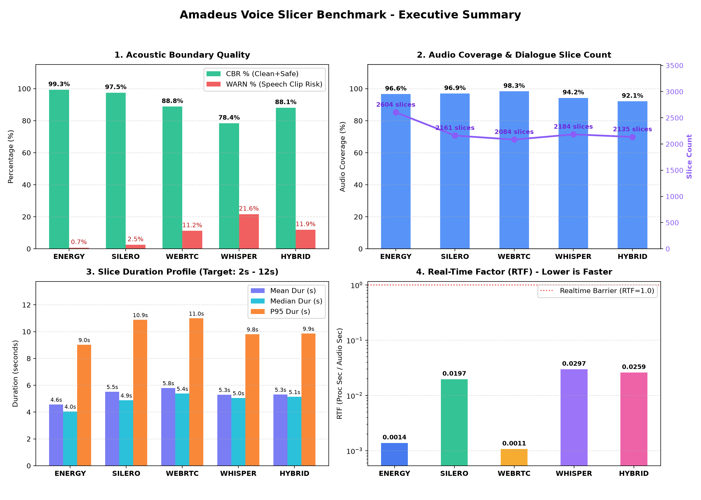
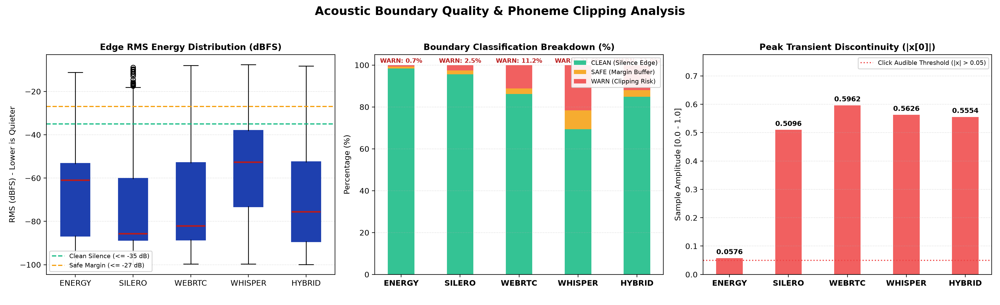
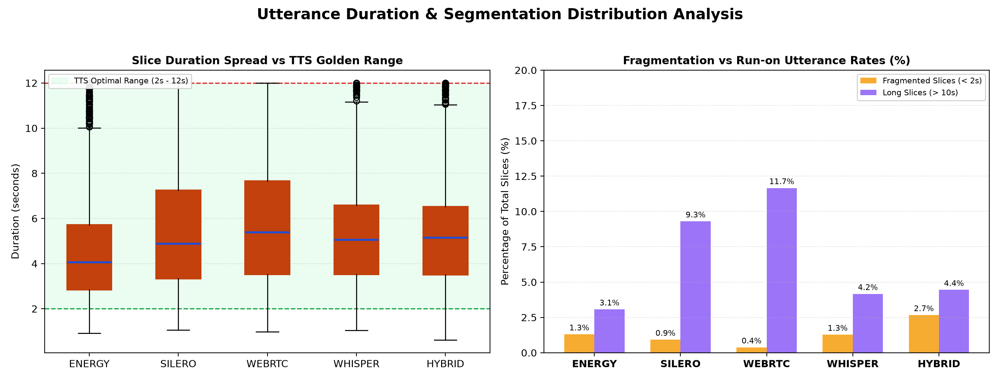

# Audio Slicer Comparative Benchmark Report

> [!IMPORTANT]
> **PHASE 2.1 EVALUATION: AUDIO SLICING & BOUNDARY SEGMENTATION**  
> This benchmark evaluates exclusively **Phase 2.1 (Audio Slicing & Boundary Segmentation)** of the speech pipeline on the input audio listed in the provenance table below (`kurisu_raw.wav`). Downstream stages (Phase 3: Semantic Tagging & ASR, Phase 4: Acoustic Modeling & Downstream Synthesis Quality) are independent and evaluated in subsequent pipeline phases.

---

## 1. Executive Summary & Comparative Matrix


## 2. Acoustic Boundary Quality & Discontinuity Inspection


## 3. Utterance Duration Spread & TTS Window Compliance


---

## 4. Multi-Dimensional Benchmark Evaluation

### Table 1: Acoustic Boundary Quality (Physical Safety & Click Prevention)
Audited across the first and last 25ms of each extracted slice:
- **`CLEAN`**: Edge RMS $\le -35\text{ dBFS}$, $\text{EER} \le 0.20$, and step jump $|x[0]| \le 0.02$.
- **`SAFE`**: Edge RMS $\le -27\text{ dBFS}$, $\text{EER} \le 0.45$, and step jump $|x[0]| \le 0.05$.
- **`WARN`**: Speech clipping or transient step discontinuity risk.

Measured on the raw cut, before the raised-cosine fade and loudness normalization that
`voice_dataset_miner.py` applies when writing files. This is deliberate: it grades the
slicer's choice of boundary, and a faded file would report a step jump of ~0 by construction.

| Slicer Algorithm | Total Slices | CBR % (Clean+Safe) | Clean % | Warn % | P95 Edge RMS | Max Step Jump | Consecutive Overlaps |
| :--- | :---: | :---: | :---: | :---: | :---: | :---: | :---: |
| **`energy`** (EnergySlicer) | 2,604 | **99.3%** | 98.3% | 0.7% | -46.0 dBFS | 0.0576 | 0 (0.0ms) |
| **`silero`** (SileroSlicer) | 2,161 | **97.5%** | 95.6% | 2.5% | -47.8 dBFS | 0.5096 | 0 (0.0ms) |
| **`webrtc`** (WebRTCSlicer) | 2,084 | **88.8%** | 86.2% | 11.2% | -25.1 dBFS | 0.5962 | 0 (0.0ms) |
| **`whisper`** (WhisperXSlicer) | 2,184 | **78.4%** | 69.4% | 21.6% | -18.0 dBFS | 0.5626 | 0 (0.0ms) |
| **`hybrid`** (HybridSlicer) | 2,135 | **88.1%** | 84.9% | 11.9% | -23.3 dBFS | 0.5554 | 0 (0.0ms) |

---

### Table 2: Segmentation Distribution & TTS Golden Range [2s – 10s] Compliance
Evaluates conversational naturalness and attention window safety for autoregressive TTS models.
`Audio Coverage %` is total slice duration / total audio duration; every slice is padded with
silence, so this counts silence as retained and is not a speech-only coverage figure.

| Slicer Algorithm | Audio Coverage % (incl. silence) | Mean Duration | Median Duration | P95 Duration | Golden Range [2s-10s] % | Short Phrases (< 2s) % | Run-on (> 10s) % | Over-Max (> 12s) % |
| :--- | :---: | :---: | :---: | :---: | :---: | :---: | :---: | :---: |
| **`energy`** | 96.6% | 4.57s | 4.05s | 9.02s | **95.6%** | 1.3% | 3.1% | 0.0% |
| **`silero`** | 96.9% | 5.52s | 4.88s | 10.88s | **89.8%** | 0.9% | 9.3% | 0.0% |
| **`webrtc`** | 98.3% | 5.80s | 5.38s | 10.99s | **88.0%** | 0.4% | 11.7% | 0.0% |
| **`whisper`** | 94.2% | 5.30s | 5.05s | 9.81s | **94.6%** | 1.3% | 4.2% | 0.0% |
| **`hybrid`** | 92.1% | 5.31s | 5.14s | 9.86s | **92.9%** | 2.7% | 4.4% | 0.0% |

---

### Table 3: Computational Performance & Real-Time Factor (RTF)
Evaluated on Intel CPU + NVIDIA GPU (Whisper/Hybrid evaluated with model_size='base').
RTF = time spent inside `slicer.slice()` / audio duration. File I/O, resampling and
boundary scoring are excluded, so this figure describes the algorithm alone.

| Slicer Algorithm | Slicing Time | Real-Time Factor (RTF) | Processing Speedup |
| :--- | :---: | :---: | :---: |
| **`energy`** | 17.0s | **0.00138** | 725× faster than realtime |
| **`silero`** | 241.9s | **0.01966** | 51× faster than realtime |
| **`webrtc`** | 13.1s | **0.00107** | 935× faster than realtime |
| **`whisper`** | 365.4s | **0.02970** | 34× faster than realtime |
| **`hybrid`** | 318.8s | **0.02592** | 39× faster than realtime |

---

## 4b. Benchmark Provenance & Reproducibility
| Field | Value |
| :--- | :--- |
| Generated (UTC) | 2026-11-09T17:04:48+00:00 |
| Input files | kurisu_raw.wav |
| Input duration | 12301.43 s |
| Sample per file | FULL (100%) |
| Device | cuda |
| Slicing Whisper | base (float16) |
| Language | ja |
| Failed slicers | 0 |
| Versions | numpy 1.26.4, scipy 1.17.1, soundfile 0.14.0, faster-whisper 1.2.1, torch 2.14.1, silero-vad 6.2.3, webrtcvad-wheels 2.0.14.post1 |

---

## 5. Engineering Conclusion & Strategy Recommendation

> All figures in this section are computed from the current `results`; no performance constant is stored in the report generator.

### Primary Recommendation: `--slicer energy`
- **Duration suitability:** 95.6% of 2,604 slices fall in the 2–10 s training window (mean 4.57 s, P95 9.02 s).
- **Boundary safety:** CBR 99.3% (CLEAN + SAFE), WARN 0.7%, over-12 s share 0.0%.
- **Audio coverage:** 96.6% of the source duration is inside slices. This metric counts silence as retained; it is not a speech-only coverage figure.
- **Cost:** RTF 0.00138, i.e. 725× faster than real time.

### Secondary Recommendation: `--slicer webrtc`
- Fastest measured strategy: RTF 0.00107 (935× realtime).
- 88.0% in [2s–10s], CBR 88.8%, WARN 11.2%, coverage 98.3% (includes silence), mean 5.80s, P95 10.99s, RTF 0.00107 (935× realtime).

### Per-Algorithm Observations
- **`energy`**: 95.6% in [2s–10s], CBR 99.3%, WARN 0.7%, coverage 96.6% (includes silence), mean 4.57s, P95 9.02s, RTF 0.00138 (725× realtime).
- **`silero`**: 89.8% in [2s–10s], CBR 97.5%, WARN 2.5%, coverage 96.9% (includes silence), mean 5.52s, P95 10.88s, RTF 0.01966 (51× realtime).
- **`webrtc`**: 88.0% in [2s–10s], CBR 88.8%, WARN 11.2%, coverage 98.3% (includes silence), mean 5.80s, P95 10.99s, RTF 0.00107 (935× realtime).
- **`whisper`**: 94.6% in [2s–10s], CBR 78.4%, WARN 21.6%, coverage 94.2% (includes silence), mean 5.30s, P95 9.81s, RTF 0.02970 (34× realtime).
- **`hybrid`**: 92.9% in [2s–10s], CBR 88.1%, WARN 11.9%, coverage 92.1% (includes silence), mean 5.31s, P95 9.86s, RTF 0.02592 (39× realtime).

### Boundary and Coverage Highlights
- **Highest CBR:** `energy` at 99.3% (WARN 0.7%).
- **Highest audio coverage:** `webrtc` at 98.3% (includes silence).
- **Hybrid vs Whisper micro-refinement:** CBR +9.7 pp, WARN reduction 9.7 pp.
- **Energy merge behaviour:** 95.6% in the golden range, 1.3% below 2 s, 3.1% above 10 s.

### No Disqualified Algorithms
No strategy crossed the disqualification thresholds (WARN ≥ 30% or run-on ≥ 20%).

---

## 6. Boundary Quality Verification
To mathematically inspect extracted audio slice boundaries:
```bash
.venv/bin/python scripts/verify_boundaries.py --slices-dir datasets/processed/energy/slices
```
Each slice is audited across its first and last 25ms:
- **`[CLEAN]`**: Edge RMS <= -35 dBFS (quiet silence onset/offset).
- **`[SAFE]`**: Edge RMS <= -27 dBFS with Edge Energy Ratio (EER) <= 0.45 and transient jump |x[0]| <= 0.05.
- **`[WARN]`**: Edge energy exceeding thresholds, indicating potential phonetic clipping.
