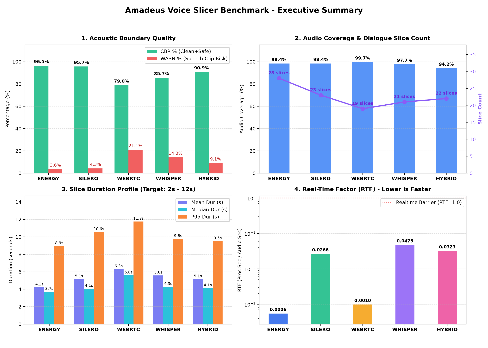
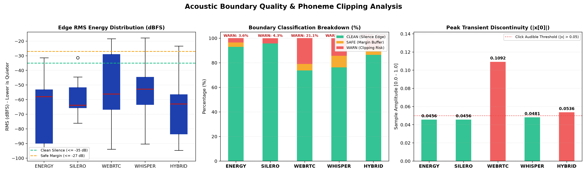
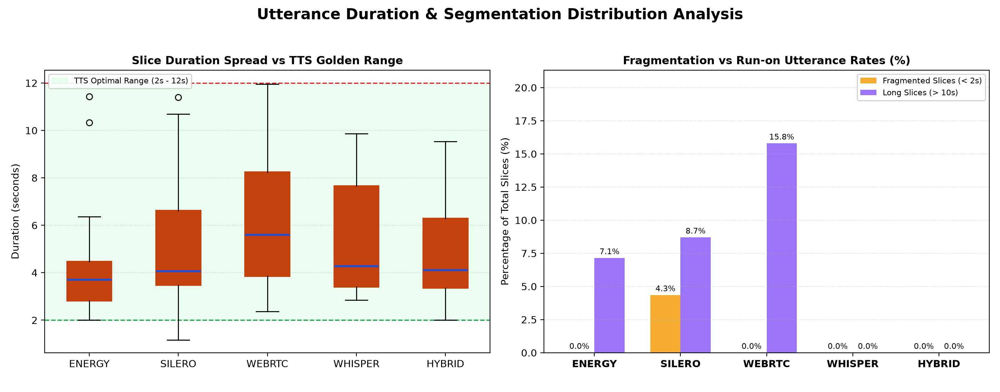

# Audio Slicer Comparative Benchmark Report

> [!IMPORTANT]
> **PHASE 2 EVALUATION ONLY: AUDIO SLICING & BOUNDARY SEGMENTATION**  
> This benchmark evaluates exclusively **Phase 2 (Audio Slicing & Boundary Segmentation)** of the speech pipeline on continuous dialogue audio (`sample_dialogue.wav`). Downstream stages (Phase 3: Semantic Tagging & ASR, Phase 4: Acoustic Modeling & Downstream Synthesis Quality) are independent and evaluated in subsequent pipeline phases.

---

## 1. Executive Summary & Comparative Matrix


## 2. Acoustic Boundary Quality & Discontinuity Inspection


## 3. Utterance Duration Spread & TTS Window Compliance


---

## 4. Multi-Dimensional Benchmark Evaluation

### Table 1: Acoustic Boundary Quality (Physical Safety & Click Prevention)
Audited across the first and last 25ms of each extracted slice:
- **`CLEAN`**: Edge RMS $\le -35\text{ dBFS}$, $\text{EER} \le 0.20$, and step jump $|x[0]| \le 0.02$.
- **`SAFE`**: Edge RMS $\le -27\text{ dBFS}$, $\text{EER} \le 0.45$, and step jump $|x[0]| \le 0.05$.
- **`WARN`**: Speech clipping or transient step discontinuity risk.

Measured on the raw cut, before the raised-cosine fade and loudness normalization that
`voice_dataset_miner.py` applies when writing files. This is deliberate: it grades the
slicer's choice of boundary, and a faded file would report a step jump of ~0 by construction.

| Slicer Algorithm | Total Slices | CBR % (Clean+Safe) | Clean % | Warn % | P95 Edge RMS | Max Step Jump | Consecutive Overlaps |
| :--- | :---: | :---: | :---: | :---: | :---: | :---: | :---: |
| **`energy`** (EnergySlicer) | 28 | **96.5%** | 92.9% | 3.6% | -41.7 dBFS | 0.0456 | 0 (0.0ms) |
| **`silero`** (SileroSlicer) | 23 | **95.7%** | 95.7% | 4.3% | -47.1 dBFS | 0.0456 | 0 (0.0ms) |
| **`webrtc`** (WebRTCSlicer) | 19 | **79.0%** | 73.7% | 21.1% | -26.7 dBFS | 0.1092 | 0 (0.0ms) |
| **`whisper`** (WhisperXSlicer) | 21 | **85.7%** | 76.2% | 14.3% | -28.6 dBFS | 0.0481 | 0 (0.0ms) |
| **`hybrid`** (HybridSlicer) | 22 | **90.9%** | 86.4% | 9.1% | -40.4 dBFS | 0.0536 | 0 (0.0ms) |

---

### Table 2: Segmentation Distribution & TTS Golden Range [2s – 10s] Compliance
Evaluates conversational naturalness and attention window safety for autoregressive TTS models.
`Audio Coverage %` is total slice duration / total audio duration; every slice is padded with
silence, so this counts silence as retained and is not a speech-only coverage figure.

| Slicer Algorithm | Audio Coverage % (incl. silence) | Mean Duration | Median Duration | P95 Duration | Golden Range [2s-10s] % | Short Phrases (< 2s) % | Run-on (> 10s) % | Over-Max (> 12s) % |
| :--- | :---: | :---: | :---: | :---: | :---: | :---: | :---: | :---: |
| **`energy`** | 98.4% | 4.22s | 3.71s | 8.94s | **92.9%** | 0.0% | 7.1% | 0.0% |
| **`silero`** | 98.4% | 5.14s | 4.06s | 10.55s | **87.0%** | 4.3% | 8.7% | 0.0% |
| **`webrtc`** | 99.7% | 6.30s | 5.59s | 11.75s | **84.2%** | 0.0% | 15.8% | 0.0% |
| **`whisper`** | 97.7% | 5.58s | 4.27s | 9.76s | **100.0%** | 0.0% | 0.0% | 0.0% |
| **`hybrid`** | 94.2% | 5.14s | 4.11s | 9.50s | **100.0%** | 0.0% | 0.0% | 0.0% |

---

### Table 3: Computational Performance & Real-Time Factor (RTF)
Evaluated on Intel CPU + NVIDIA GPU (Whisper/Hybrid evaluated with model_size='base').
RTF = time spent inside `slicer.slice()` / audio duration. File I/O, resampling and
boundary scoring are excluded, so this figure describes the algorithm alone.

| Slicer Algorithm | Slicing Time | Real-Time Factor (RTF) | Processing Speedup |
| :--- | :---: | :---: | :---: |
| **`energy`** | 0.1s | **0.00055** | 1,818× faster than realtime |
| **`silero`** | 3.2s | **0.02664** | 38× faster than realtime |
| **`webrtc`** | 0.1s | **0.00099** | 1,010× faster than realtime |
| **`whisper`** | 5.7s | **0.04752** | 21× faster than realtime |
| **`hybrid`** | 3.9s | **0.03230** | 31× faster than realtime |

---

## 4b. Benchmark Provenance & Reproducibility
| Field | Value |
| :--- | :--- |
| Generated (UTC) | 2026-11-09T16:48:11+00:00 |
| Input files | kurisu_raw.wav |
| Input duration | 120.00 s |
| Sample per file | 120.0 |
| Device | cuda |
| Slicing Whisper | base (float16) |
| Language | ja |
| Failed slicers | 0 |
| Versions | numpy 1.26.4, scipy 1.17.1, soundfile 0.14.0, faster-whisper 1.2.1, torch 2.14.1, silero-vad 6.2.3, webrtcvad-wheels 2.0.14.post1 |

---

## 5. Engineering Conclusion & Strategy Recommendation

> All figures in this section are computed from the current `results`; no performance constant is stored in the report generator.

### Primary Recommendation: `--slicer hybrid`
- **Duration suitability:** 100.0% of 22 slices fall in the 2–10 s training window (mean 5.14 s, P95 9.50 s).
- **Boundary safety:** CBR 90.9% (CLEAN + SAFE), WARN 9.1%, over-12 s share 0.0%.
- **Audio coverage:** 94.2% of the source duration is inside slices. This metric counts silence as retained; it is not a speech-only coverage figure.
- **Cost:** RTF 0.03230, i.e. 31× faster than real time.

### Secondary Recommendation: `--slicer energy`
- Fastest measured strategy: RTF 0.00055 (1,818× realtime).
- 92.9% in [2s–10s], CBR 96.5%, WARN 3.6%, coverage 98.4% (includes silence), mean 4.22s, P95 8.94s, RTF 0.00055 (1,818× realtime).

### Per-Algorithm Observations
- **`energy`**: 92.9% in [2s–10s], CBR 96.5%, WARN 3.6%, coverage 98.4% (includes silence), mean 4.22s, P95 8.94s, RTF 0.00055 (1,818× realtime).
- **`silero`**: 87.0% in [2s–10s], CBR 95.7%, WARN 4.3%, coverage 98.4% (includes silence), mean 5.14s, P95 10.55s, RTF 0.02664 (38× realtime).
- **`webrtc`**: 84.2% in [2s–10s], CBR 79.0%, WARN 21.1%, coverage 99.7% (includes silence), mean 6.30s, P95 11.75s, RTF 0.00099 (1,010× realtime).
- **`whisper`**: 100.0% in [2s–10s], CBR 85.7%, WARN 14.3%, coverage 97.7% (includes silence), mean 5.58s, P95 9.76s, RTF 0.04752 (21× realtime).
- **`hybrid`**: 100.0% in [2s–10s], CBR 90.9%, WARN 9.1%, coverage 94.2% (includes silence), mean 5.14s, P95 9.50s, RTF 0.03230 (31× realtime).

### Boundary and Coverage Highlights
- **Highest CBR:** `energy` at 96.5% (WARN 3.6%).
- **Highest audio coverage:** `webrtc` at 99.7% (includes silence).
- **Hybrid vs Whisper micro-refinement:** CBR +5.2 pp, WARN +5.2 pp.
- **Energy merge behaviour:** 92.9% in the golden range, 0.0% below 2 s, 7.1% above 10 s.

### No Disqualified Algorithms
No strategy crossed the disqualification thresholds (WARN ≥ 30% or run-on ≥ 20%).

---

## 6. Boundary Quality Verification
To mathematically inspect extracted audio slice boundaries:
```bash
.venv/bin/python scripts/verify_boundaries.py --slices-dir datasets/processed/energy/slices
```
Each slice is audited across its first and last 25ms:
- **`[CLEAN]`**: Edge RMS <= -35 dBFS (quiet silence onset/offset).
- **`[SAFE]`**: Edge RMS <= -27 dBFS with Edge Energy Ratio (EER) <= 0.45 and transient jump |x[0]| <= 0.05.
- **`[WARN]`**: Edge energy exceeding thresholds, indicating potential phonetic clipping.
